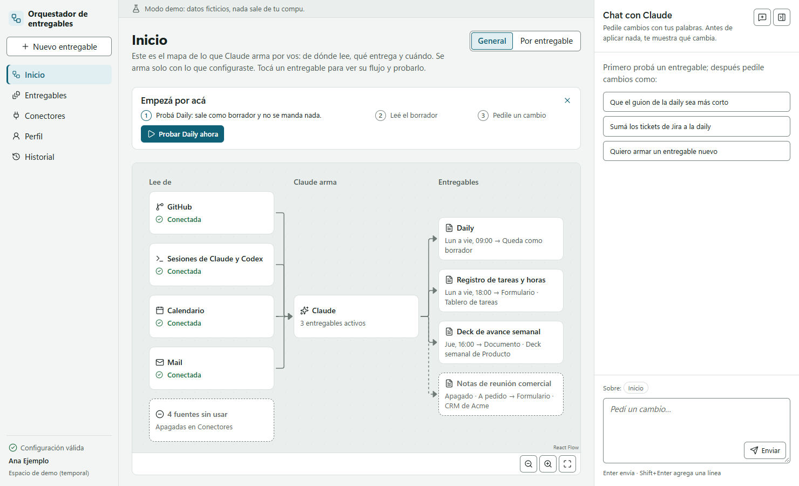
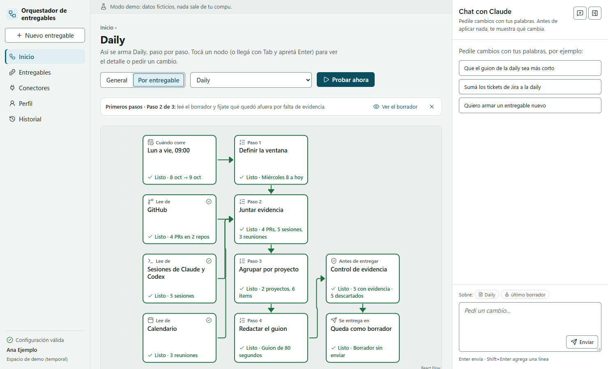
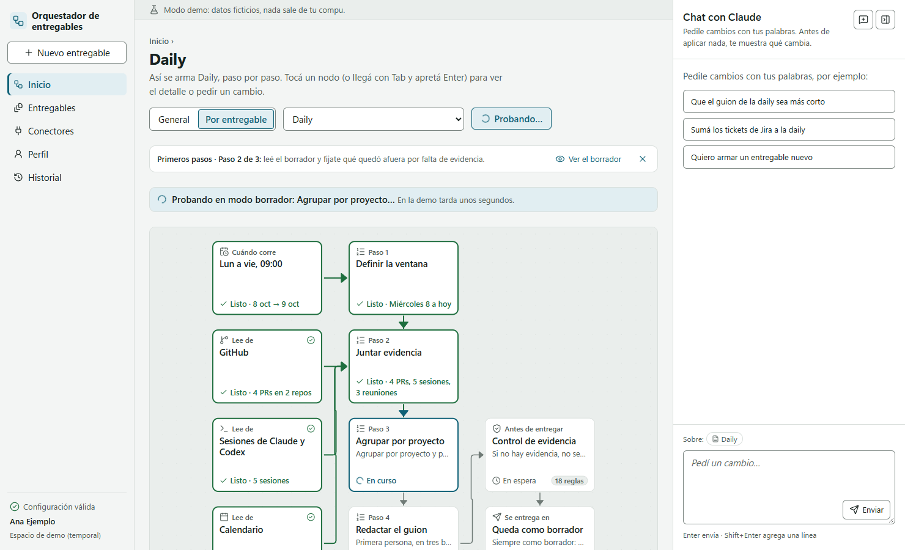
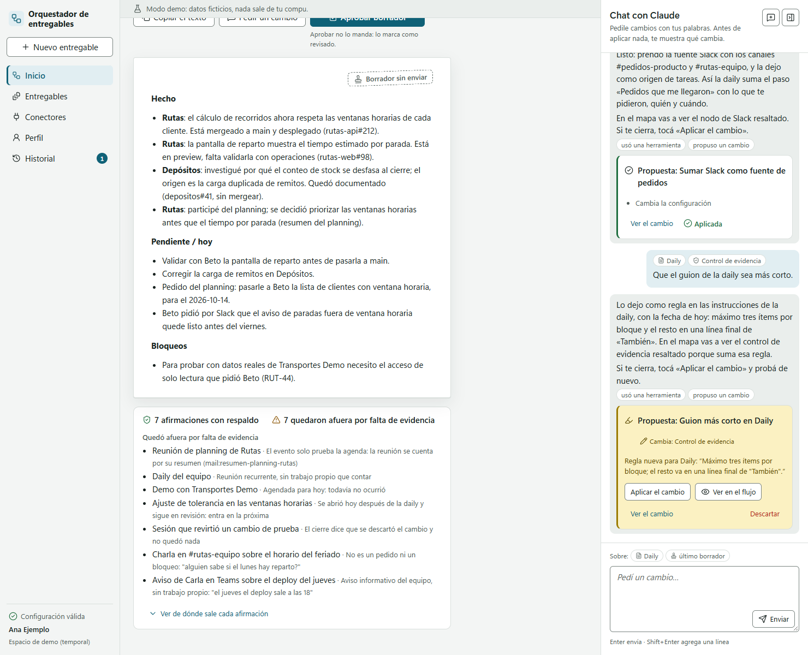
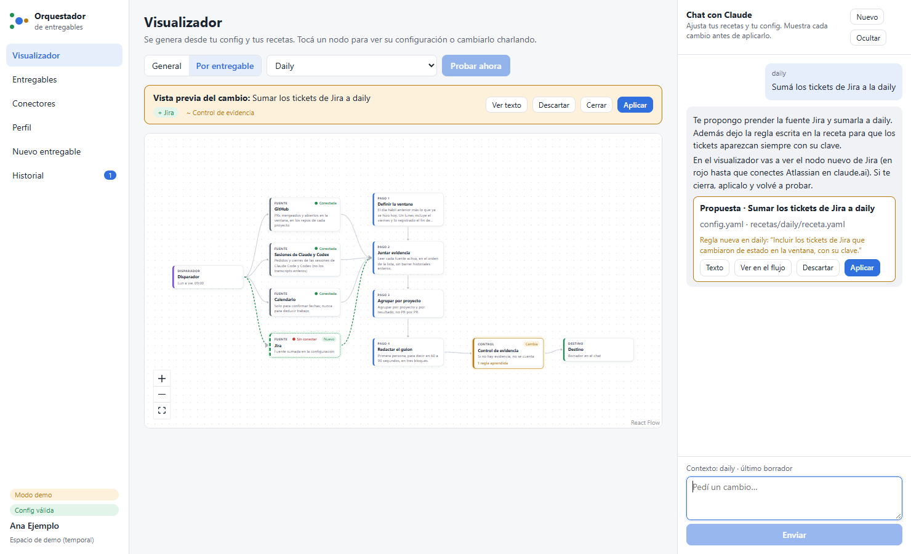
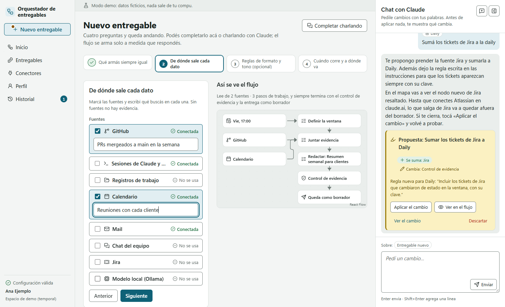
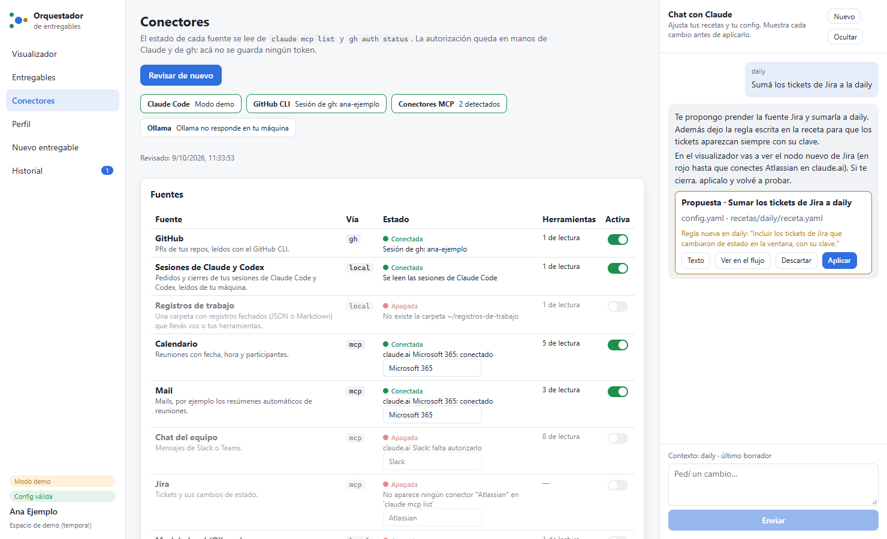
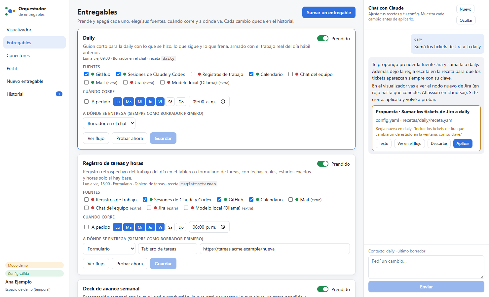

# Orquestador de entregables

**De PRs, reuniones y pedidos a un borrador con evidencia, listo para que una persona lo revise.**

Una plantilla configurable para los entregables que un equipo prepara una y otra vez: la daily, el registro de tareas, el deck de avance, las notas de una reunión y la bitácora semanal. Combina recetas, una interfaz web local y Claude Code para reunir las fuentes y dejar visible cómo se armó cada borrador.

**[Probar la demo pública](https://orquestador-entregables.vercel.app) · [Ver la presentación](docs/presentacion.md) · [Mi trabajo y contacto](https://tomas-garbarino.vercel.app/)**

La demo usa **datos ficticios y corridas simuladas**. Permite explorar el flujo sin conectar cuentas ni ejecutar modelos; no muestra lecturas reales de GitHub, chats o reuniones.



## Qué problema resuelve

La información del trabajo suele estar repartida entre código, tickets, chats y reuniones. Para preparar una actualización, alguien tiene que volver a buscarla, separar lo hecho de lo pendiente y adaptarla al formato del equipo.

El orquestador permite definir ese proceso una vez como una **receta**: cuándo corre, qué fuentes lee, qué pasos sigue, qué evidencia exige y dónde se revisa el resultado. El objetivo es hacer repetible esa preparación; el ahorro de tiempo debe medirse en cada equipo.

### Un ejemplo: preparar la daily

1. La receta determina el período y las fuentes habilitadas.
2. Lee las fuentes disponibles y registra sus referencias. Una reunión sin resumen queda indicada como tal.
3. Claude prepara el borrador; el control comprueba que las referencias citadas estén entre las lecturas registradas.
4. El visualizador muestra qué se leyó, qué falló y qué quedó pendiente.
5. La persona revisa y corrige el borrador. Enviarlo o cargarlo en otro sistema es una acción separada que requiere su OK.

**Las corridas de la interfaz, la consola y las rutinas programadas generan borradores; no envían mensajes ni cargan formularios.**

## Qué podés hacer hoy

| Necesidad | Función disponible |
| --- | --- |
| Repetir un formato sin reescribir el pedido | Recetas para daily, tareas, deck de avance, reunión comercial y bitácora de reuniones. |
| Entender de dónde salió el borrador | Visualizador de fuentes y pasos, resultados por nodo y referencias. |
| Ajustar el entregable | Chat que propone cambios y muestra la diferencia antes de aplicarlos. |
| Agregar otro proceso | Asistente de cuatro pasos que crea la receta y su configuración. |
| Compartir criterios dentro del equipo | Exportación/importación de `equipo.yaml`, separada de la configuración personal. |
| Preparar entregables por horario | Rutinas locales que dejan borradores en la interfaz. |
| Adaptar las fuentes | GitHub y sesiones locales; conectores MCP autorizados para chat, calendario, mail, tickets y resúmenes de reuniones. |

La disponibilidad de cada fuente depende de la cuenta, los permisos y los conectores configurados. Un conector listado no implica que esté conectado o validado con datos reales en tu entorno.



<details>
<summary>Ver más pantallas</summary>













</details>

## Elegí cómo evaluarlo

| Modo | Qué hace | Qué necesitás |
| --- | --- | --- |
| **Demo pública** | Simula corridas, datos y cambios desde el navegador. | Abrir el enlace de la demo. |
| **Demo local** (`npm run demo`) | Abre un espacio temporal con datos ficticios y simulación de corridas/chat. | Node.js, npm y las dependencias del repo. |
| **Uso con fuentes reales** (`npm start`) | Usa tu espacio local y ejecuta las recetas con Claude Code. | Claude Code con sesión, skills y MCP del orquestador, más las fuentes que autorices. |

### Probar la demo local

El proyecto declara Node.js 20 o superior en `package.json`. Instalá una versión compatible con sus dependencias y git; después:

```sh
git clone https://github.com/tomigarbarino/orquestador-entregables.git
cd orquestador-entregables
npm ci
npm run demo
```

La interfaz abre en **http://127.0.0.1:4317**. Este modo no necesita conectar cuentas ni hacer inferencia.

### Instalar para usar fuentes reales

Desde la carpeta del repo, elegí tu plataforma:

**Windows / PowerShell:**

```powershell
powershell -ExecutionPolicy Bypass -File scripts\instalar.ps1
```

**macOS / Linux:**

```bash
bash scripts/instalar.sh
```

Los scripts instalan dependencias y, si falta, Claude Code. Después enlazan las skills `orquestador-entregables` y `nuevo-entregable`, registran el servidor MCP del orquestador en Claude Code, crean `mi-espacio/` si no existe y abren la interfaz. Si ya hay otra skill con el mismo nombre, no la reemplazan.

Con las dependencias y Claude Code ya instalados, podés revisar el plan sin aplicarlo:

```sh
node scripts/instalar.mjs --revisar
```

Si falta iniciar sesión en Claude Code, usá `claude auth login` en la terminal. Las credenciales se gestionan con las herramientas de cada servicio, no pegándolas en la configuración del proyecto.

## Configurar tu primer entregable

1. **Abrí la interfaz:** `npm start`.
2. **Perfil:** definí equipo, zona horaria, proyectos y reglas de redacción.
3. **Conectores:** revisá cuáles responden. Para GitHub, `gh auth login`; para otras fuentes, el conector autorizado en Claude. Las sesiones de Claude Code y Codex se leen de la máquina.
4. **Entregables:** habilitá la daily y elegí sus fuentes. Podés indicar de dónde llegan los pedidos para separar solicitudes de trabajo realizado.
5. **Visualizador:** Daily → **Probar ahora**. Revisá tanto el borrador como las fuentes que faltaron.
6. **Ajustá:** pedí un cambio en el chat, revisá la diferencia y aplicá solo lo que corresponda. Volvé a probar.

Desde Claude Code también podés pedir «armá la daily», «qué entregables tocan hoy» o «quiero sumar un entregable nuevo». Las recetas propias se guardan en `mi-espacio/recetas/<id>/`.

### Equipo, reuniones y módulos

- **Perfil de equipo:** exportá una base compartida desde Perfil e importala en otro espacio; cada persona ajusta su configuración. El archivo exportado excluye los datos personales previstos por el esquema.
- **Bitácora:** por día o por semana, reúne temas, decisiones, responsables y referencias al resumen. Una reunión sin resumen queda separada, sin completar el contenido por suposición.
- **Módulos opcionales:** digest de Jira, seguimiento de próximos pasos comerciales y resumen con un modelo local de Ollama. Vienen apagados y tienen que validarse con las fuentes del equipo.

### Rutinas programadas

En **Entregables → Rutinas programadas** se revisa y aplica el plan. En Windows usa el Programador de tareas; en macOS/Linux, crontab. La computadora debe estar encendida y Claude Code disponible con sesión iniciada.

`npm run programar` muestra el plan; `npm run programar -- --aplicar` lo aplica. Las rutinas dejan borradores, no envíos.

## Cómo está construido

**Stack:** Node.js, React, React Flow, Vite, Express y un servidor MCP para Claude Code. La configuración usa YAML y esquemas; los datos de cada espacio viven en archivos y un historial git local.

```text
recetas/             entregables genéricos y sus instrucciones
modulos/             capacidades opcionales
esquema/             validación de configuración y recetas
conectores/          catálogo de fuentes y herramientas de lectura
skills/              instrucciones de orquestación y creación de entregables
mcp/servidor.mjs     herramientas del orquestador para Claude Code
servidor/            interfaz local en 127.0.0.1
web/                 React, visualizador y demo estática
lib/                 recetas, horarios, fuentes, corridas y validación
mi-espacio/          configuración, recetas propias, corridas e historial; ignorado por git
```

Para revisar las decisiones y límites de cada función, empezá por [docs/funcionalidades.md](docs/funcionalidades.md). Incluye el flujo completo, archivos relevantes, validaciones registradas y riesgos conocidos.

### Comandos de verificación

| Comando | Qué permite revisar |
| --- | --- |
| `npm test` | Tests de lógica, recetas, control, fuentes, semilla y textos. |
| `npm run smoke` | Flujo de ejemplo sin usar tu espacio personal. |
| `npm run validar` | Configuración y recetas del espacio seleccionado. |
| `npm run correr -- daily` | Una corrida en modo borrador desde la consola. |
| `npm run build:demo` | Compila la demo estática en `dist-demo/`. |
| `npm run escanear` | Busca posibles datos personales y secretos antes de publicar. |

El instalador se deshace con `node scripts/instalar.mjs --desinstalar`; conserva el espacio y sus datos.

## Límites que importan al adoptarlo

- **Demo y uso real son distintos.** La demo no demuestra acceso a cuentas ni calidad de una corrida real.
- **Las referencias no garantizan toda la redacción.** El control comprueba referencias contra las lecturas; una persona debe revisar las conclusiones. La documentación registra problemas de redacción, estado y detalle sensible en decks largos.
- **Costo y calidad dependen de las fuentes y del modelo.** Los ejemplos de consumo registrados no son una tarifa ni un ahorro garantizado. El ahorro de tiempo todavía debe medirse por entregable.
- **El espacio es local, pero Claude y los conectores pueden procesar datos externos.** Correr la interfaz en la máquina no significa que toda inferencia sea local. Ollama es un módulo opcional de resumen.
- **Los permisos necesitan revisión por fuente.** El servidor escucha en localhost, el chat tiene herramientas acotadas y las corridas usan fuentes de lectura; el entorno y los conectores siguen formando parte del límite de confianza.
- **Ignorar una carpeta no la limpia.** `mi-espacio/` está en `.gitignore`; revisá los cambios y el escaneo antes de compartir un fork o una configuración.

## Adaptarlo a un equipo

El primer paso es elegir **un entregable**, sus fuentes, el formato esperado y quién lo aprueba. Eso permite evaluar la calidad del borrador y medir la preparación manual antes de ampliar el flujo a otros procesos.

**[Ver mi trabajo y conversar sobre una adaptación](https://tomas-garbarino.vercel.app/)**

## Licencia

[MIT](LICENSE).
