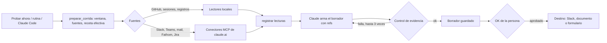

# Orquestador de entregables: funcionalidades

## Resumen

Los entregables que cada persona arma siempre igual (daily, registro de tareas y horas, deck de avance semanal, notas de reunión comercial, bitácora de reuniones) se configuran una vez. Claude junta lo que pasó desde las fuentes conectadas, arma un borrador con evidencia y la persona decide qué sale. Nada se envía sin OK, lo que no tiene evidencia no se cuenta y las credenciales quedan en Claude Code y en el GitHub CLI.

## Experiencia de uso

**Quién lo usa:** cualquier persona con Claude Code, aunque no sea técnica. Corre en su compu (`npm start` abre `http://127.0.0.1:4317`).

**Qué puede hacer:**

- **Inicio:** ver qué toca hoy y el mapa general: fuentes a la izquierda, Claude en el medio y entregables a la derecha. Las fuentes se pintan de verde o de rojo según estén conectadas.
- **Por entregable:** ver el flujo paso a paso y tocar **Probar ahora**. El paso en curso se ilumina en vivo y, al terminar, cada nodo dice qué encontró. El borrador aparece abajo, con su evidencia y lo que quedó afuera con su motivo.
- **Chat con Claude:** pedir cambios en castellano ("esto sobra", "sumá Jira"). Antes de aplicar, el mapa muestra qué nodos se agregan, se quitan o cambian. Cada corrección queda como regla fechada de la receta y todo se puede deshacer desde **Historial**.
- **Nuevo entregable:** cuatro preguntas (qué armás, de dónde sale cada dato, reglas de formato, cuándo corre) con el flujo dibujándose al costado.
- **Conectores:** el estado de GitHub, las sesiones de Claude Code y Codex, el calendario, el mail, las reuniones (Fathom u Outlook), Slack, Teams y Jira. Lo que se conecta en claude.ai se agrega desde ahí con su link.
- **Perfil:**
  - Dónde le llegan las tareas a cada persona (Slack, Teams, mail, reuniones, GitHub). Con eso, la daily y el registro suman el paso "Pedidos que me llegaron".
  - El perfil de equipo (`equipo.yaml`): las fuentes y reglas que comparte el equipo, con lo de cada persona encima.
- **Desde Claude Code:** "armá la daily", "qué toca hoy" o "programá las rutinas" (skill `orquestador-entregables`).

**Límites visibles:**

- Las fuentes sin conector no aportan evidencia.
- Una reunión sin resumen queda aparte: no se inventa qué se habló.
- Los módulos opcionales (digest de Jira, seguimiento comercial, resumen local con Ollama) vienen apagados.
- La demo pública (https://orquestador-entregables-tomas.vercel.app) usa datos ficticios y corre entera en el navegador.

## Panorama técnico

| Pieza | Archivos |
|---|---|
| Interfaz (React 19 + React Flow 12, servida por Vite en modo middleware) | `web/src/App.jsx`, `web/src/paginas/*`, `web/src/componentes/*` |
| Servidor local (Express 5, solo 127.0.0.1, SSE para el avance) | `servidor/index.mjs` |
| Servidor MCP del orquestador (modos corrida, chat y completo) | `mcp/servidor.mjs` |
| Corridas con `claude -p` (stream-json, herramientas en lista blanca) | `lib/claude.mjs`, `lib/orquestacion.mjs`, `lib/corridas.mjs` |
| Lectores locales (GitHub, issues, sesiones de IA, registros) | `lib/fuentes-locales.mjs` |
| Conectores (`claude mcp list`, `gh auth status`, catálogo) | `lib/conectores.mjs`, `conectores/catalogo.yaml` |
| Config, perfil de equipo y validación (JSON Schema con ajv) | `esquema/*.schema.json`, `lib/validar.mjs`, `lib/equipo.mjs` |
| Recetas y módulos | `recetas/*/receta.yaml` + `instrucciones.md`, `modulos/*`, `lib/receta-efectiva.mjs` |
| Grafo del visualizador | `lib/grafo.mjs` |
| Propuestas del chat e historial con git local | `lib/propuestas.mjs`, `lib/historial.mjs` |
| Rutinas programadas (schtasks o crontab) | `lib/rutinas.mjs`, `scripts/programar.mjs` |
| Demo estática (backend en el navegador) | `web/src/demo/backend.js`, `ejemplo/demo/semilla/`, `scripts/build-demo.mjs`, `vercel.json` |

**Datos:** no hay base de datos. Todo vive en el espacio de la persona (`mi-espacio/`, ignorado por git):

- `config.yaml` y `equipo.yaml`;
- `recetas/` propias;
- `corridas/<id>/` (meta, eventos, lecturas, evidencia y borrador);
- `.propuestas/`;
- un repo git local para el historial.

**Control de evidencia:**

- Cada ítem del borrador cita refs.
- Todas sus refs tienen que estar en `lecturas.json`. Los descartados también llevan ref, y cada nodo termina con un estado.
- Hasta tres intentos; después se guarda con observaciones.

**Seguridad:**

- El servidor rechaza otros hosts y exige el header `x-orquestador`.
- El chat solo usa el MCP en modo chat (lee y propone cambios a la config y las recetas).
- Las corridas tienen `--tools ""` y solo herramientas de lectura.
- No se guardan tokens.

**Lo que llega a producción por una convergencia:**

- Un PR mergeado a otra rama antes del período que llegó a producción dentro del período se detecta con el primer padre del merge del release.
- Se cuenta con `llego_a_produccion_el` y `via`.
- Se leen hasta 200 PRs por repo, con aviso si se llega al tope.

## Flujo de una corrida

## Notas operativas

- **Requisitos:** Node 20 o más nuevo, Claude Code logueado y GitHub CLI (`gh auth login`). La instalación es `scripts/instalar.ps1` o `scripts/instalar.sh`: enlaza las skills en `~/.claude/skills`.
- **Costo por corrida** (con Sonnet, datos reales):
  - Daily: alrededor de US$ 2,5, con Slack, Teams, mail y reuniones.
  - Deck de avance: entre US$ 2 y 3 (31 a 39 slides).
- **Demo:** `npm run demo` (servidor con espacio temporal) o `npm run build:demo` (estática, la que publica Vercel).
- **Fathom:** se usa el MCP oficial (`https://api.fathom.ai/mcp`). Como no publica los nombres de sus herramientas, se habilita el servidor entero, que es de lectura.

## Validación

- `npm test`: 111 tests pasan (lógica, recetas, control, fuentes, fuentes de chat y reuniones, origen de tareas, semilla, textos).
- `npm run smoke`: 16 de 16 flujos.
- `node scripts/escanear.mjs`: sin hallazgos (mails, teléfonos, tokens, URLs internas, nombres).
- `npm run build:demo` y deploy en Vercel: OK, con el arreglo del chat verificado en el bundle publicado.
- **Corridas reales con la config del autor:**
  - Daily: 15 ítems con evidencia, control OK.
  - Reunión comercial y registro de tareas: aprobados con observaciones por revisores independientes.
  - Deck de avance: lectura completa (115 PRs del período), pero rechazado por los revisores por reglas de redacción y seguridad (ver riesgos).
- Video de 2 minutos sobre la demo pública, revisado cuadro por cuadro.

## Riesgos y próximos pasos

- **Deck de avance:** en decks largos, el modelo de las corridas no cumple todas las reglas: muestra riesgos abiertos como cerrados, da detalle de vulnerabilidades, marca estados sin confirmar y usa títulos que arrancan por el error. Queda como borrador para revisar a mano. Opciones: un paso de autorrevisión contra las reglas o correrlo con un modelo más grande.
- **Fathom:** acotar los permisos por herramienta cuando publiquen sus nombres.
- **Digest de Jira:** probarlo con datos reales.
- **Tiempo ahorrado:** medirlo por entregable en un piloto con equipos.
- **Destino:** definir en qué organización de GitHub queda el repo.
